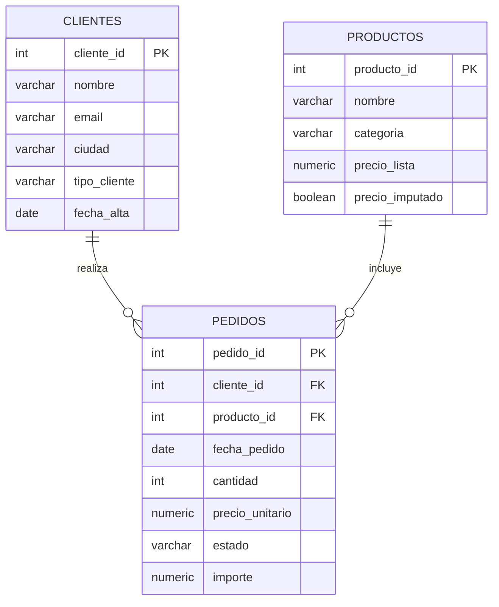

# Proyecto Capstone: Análisis Exploratorio de Datos (EDA) en PostgreSQL

**Autora:** Yarovid Matamoros
**Motor:** PostgreSQL 13 o superior (probado en PostgreSQL 16)

## 1. Problema de negocio

*SeguriTech* es una distribuidora **ficticia** de equipamiento de seguridad electrónica: cámaras, grabadores (NVR), almacenamiento, alarmas, control de acceso y redes. Le vende a particulares y a clientes institucionales (municipios, barrios cerrados, hoteles y colegios).

La dirección necesita decidir **dónde poner el esfuerzo comercial y de stock para 2026**. Este análisis de las ventas de 2025 busca responder:

1. ¿Quiénes son nuestros 5 clientes más valiosos y cuánto dependemos de ellos?
2. ¿Cómo se comportan las ventas mes a mes? ¿Hay estacionalidad?
3. ¿Cuáles son los 3 productos menos vendidos?
4. ¿Cuáles son los pedidos más grandes de cada categoría y qué categorías sostienen la facturación?
5. ¿Qué segmento de cliente (institucional o particular) sostiene el negocio?
6. ¿Cuánto perdemos por cancelaciones y en qué categoría?

> **Sobre el dataset:** los datos son **simulados**, generados para este proyecto según la opción del enunciado "creá vos mismo 3 tablas: clientes, pedidos y productos". Se cargaron a propósito con los problemas típicos de una exportación real (nulos, formatos mixtos, duplicados) para practicar la limpieza.

## 2. Modelo de datos



| Tabla | Filas | Descripción |
|---|---|---|
| `clientes` | 15 | 10 particulares y 5 institucionales, de 7 ciudades |
| `productos` | 16 | 7 categorías |
| `pedidos` | 118 | Ventas de enero a diciembre de 2025 (105 entregadas, 13 canceladas) |

**Criterios de tipos:** los montos van en `NUMERIC(12,2)`, porque `FLOAT` genera errores de redondeo con dinero. Las fechas van en `DATE`, para poder usar `DATE_TRUNC` y `EXTRACT`. Las claves primarias y foráneas garantizan que no haya pedidos "huérfanos", y los `CHECK` impiden cantidades o precios negativos. `importe` es una columna calculada (`cantidad * precio_unitario`).

## 3. Limpieza de datos

Los datos se cargan primero **crudos**, todo como `TEXT`, en tablas `stg_*`. Después se limpian y se tipan al pasar a las tablas finales:

| Problema detectado | Casos | Tratamiento |
|---|---|---|
| Precio unitario nulo o vacío (`''`) | 20 de 121 | `NULLIF` convierte `''` en `NULL` y `COALESCE` usa el precio de lista |
| Precio de lista faltante | 2 productos | `COALESCE(precio_lista, precio promedio vendido, promedio de la categoría)`; se marca `precio_imputado = TRUE` |
| Cantidad nula | 5 | `COALESCE(cantidad, 1)`: todo pedido tiene al menos una unidad |
| Coma decimal (`185,50`) | varios | `REPLACE` antes de convertir a `NUMERIC` |
| Fechas en formatos mixtos (`AAAA-MM-DD` y `DD/MM/AAAA`) | varios | Función con `CASE` + expresión regular + `TO_DATE` |
| Fecha nula | 2 | **Se excluyen.** No se puede imputar una fecha sin inventar estacionalidad |
| Pedido duplicado por doble carga | 1 | `DISTINCT ON (pedido_id)` |
| Categorías escritas de varias formas (`CÁMARAS`, `camaras `) | 7 categorías | `TRIM` + `LOWER` + `TRANSLATE` (quita tildes) + `CASE` |
| Ciudades inconsistentes (`caba `, `cordoba`) | 4 | `CASE` de normalización |
| Estado inconsistente (`ENTREGADO `) | varios | `LOWER(TRIM())` |

El script termina con una verificación de conteos antes y después: 121 filas crudas, menos 2 sin fecha y menos 1 duplicado, dan 118 pedidos limpios.

## 4. Hallazgos principales

En 2025 se facturaron **USD 181.066** en 105 pedidos entregados.

### 4.1 El negocio depende de 5 cuentas institucionales
- Los **5 clientes institucionales** (un tercio de la cartera) generan el **89,6 %** de la facturación. Su ticket promedio es de USD 2.496, **5,3 veces** el de un particular (USD 470).
- El top 5 por gasto está formado justamente por esas 5 instituciones. Solo la **Municipalidad de Pilar** representa el **29,4 %** de las ventas (USD 53.240).
- **Lectura para la dirección:** hay un riesgo de concentración alto. Perder una sola cuenta municipal equivale a perder casi un tercio del año. Recomendamos asignar un responsable de cuenta (*key account*) a cada cliente institucional y buscar 2 o 3 cuentas institucionales nuevas para diluir esa dependencia.

### 4.2 El cuarto trimestre concentra casi la mitad de las ventas
- El **T4 aportó el 44,6 %** de la facturación anual. **Noviembre** fue el mejor mes (USD 32.153) y **abril** el más bajo (USD 2.238).
- Los picos de marzo y junio se deben a pocos pedidos grandes de proyectos institucionales, no a una demanda sostenida. Por eso la variación mensual es muy volátil (de −90 % a +834 %).
- **Lectura:** hay que asegurar stock de cámaras, NVR y switches PoE y disponibilidad de técnicos instaladores **antes de octubre**. Los meses de baja (febrero, abril y agosto) son buenos para capacitar al equipo y hacer mantenimiento preventivo.

### 4.3 Tres categorías explican dos tercios de la facturación
- **Grabadores (23,8 %), Cámaras (23,0 %) y Redes (20,3 %)** suman el 67 % de las ventas.
- Grabadores lidera con apenas 9 pedidos: es una categoría de ticket alto, donde cada venta pesa mucho. El pedido más grande del año fue un NVR de 16 canales para la Municipalidad de Pilar (USD 11.480).
- En Grabadores, `RANK()` muestra un **empate** en el 2.º puesto (dos pedidos de USD 8.118). Por eso se usó `RANK()` y no `ROW_NUMBER()`: el empate es real y no corresponde romperlo arbitrariamente.

### 4.4 Los productos menos vendidos son de nicho, no necesariamente un problema
- Los menos vendidos son la **Cámara LPR** (1 unidad), la **Cámara PTZ 25x** (2) y la **Cerradura electromagnética** (4).
- La LPR y la PTZ son productos de alto valor que se venden por proyecto. Su baja rotación es esperable, así que conviene venderlos **a pedido** y no mantener stock.
- Advertencia: el precio de la Cámara LPR fue **imputado** porque faltaba en el origen. Antes de tomar decisiones sobre ese producto hay que confirmar el precio real.

### 4.5 Las cancelaciones se concentran en Cámaras
- Se cancelaron 13 de 118 pedidos (11 %), con **USD 8.112** de venta perdida.
- **Cámaras** explica el **75 %** de ese monto (USD 6.077) y tiene la tasa de cancelación más alta (19,4 %).
- **Lectura:** conviene investigar la causa (falta de stock, plazos de entrega o precio frente a la competencia). Grabadores, Redes y Almacenamiento no tuvieron cancelaciones.

### 4.6 Segmentación de clientes
- **A - Estratégico** (más de USD 20.000): 4 clientes. **B - Recurrente** (USD 3.000 a 20.000): 3. **C - Ocasional**: 8.
- Hay un cliente registrado (**Valentina Castro**) **sin ninguna compra**. Es un candidato a campaña de reactivación.

### Limitaciones
- Los datos son simulados y cubren un solo año, así que la estacionalidad debería confirmarse con más años de historia.
- El 16,5 % de los precios unitarios se imputó con el precio de lista. Si esas ventas tuvieron descuento, la facturación real puede ser algo menor.
- No hay datos de costos, por lo que el análisis es de **ventas, no de rentabilidad**.

## 5. Cómo ejecutar el código

**Requisitos:** PostgreSQL 13 o superior y `psql` o pgAdmin 4.

**Opción A — psql (terminal)**
```bash
createdb capstone_project
psql -d capstone_project -f estructura.sql   # crea tablas, carga y limpia los datos
psql -d capstone_project -f analisis.sql     # ejecuta las consultas de análisis
```

**Opción B — pgAdmin 4**
1. Clic derecho en *Databases* → *Create* → *Database…* → nombre: `capstone_project`.
2. Seleccionar `capstone_project` → *Query Tool* → abrir `estructura.sql` → ejecutar (F5).
3. En el mismo Query Tool, abrir `analisis.sql`. Conviene ejecutar cada consulta por separado: se selecciona el bloque y se presiona F5, porque pgAdmin solo muestra el resultado de la última consulta.
4. Opcional: clic derecho en la base → *ERD Tool* para ver el diagrama.

`estructura.sql` se puede volver a ejecutar sin problemas: borra y recrea sus objetos.

## 6. Estructura del repositorio

```
├── estructura.sql   # Creación de tablas, carga de datos crudos, limpieza y verificación
├── analisis.sql     # 6 preguntas de negocio, con consultas comentadas
└── README.md        # Este documento
```

## 7. Cumplimiento de los requisitos

| Requisito | Dónde se cumple |
|---|---|
| README con contexto y hallazgos | Secciones 1 y 4 de este archivo |
| JOINs de al menos dos tablas | `analisis.sql`: preguntas 1, 3, 4, 5 y 6 (P4 une las 3 tablas) |
| Agregación (`GROUP BY`) | Todas las preguntas |
| Función avanzada | `RANK()`, `LAG()`, `SUM() OVER` (P2 y P4); `CASE` (P5, P6 y limpieza) |
| Scripts ejecutables sin errores | Probados de punta a punta en PostgreSQL 16 |
| Limpieza antes del análisis | `estructura.sql`, etapa 3; control de calidad en `analisis.sql`, sección 0 |
| `COALESCE` en columnas críticas | Precios, cantidades y productos sin ventas |
| Tipos correctos (`DATE`, `NUMERIC`) | `estructura.sql`, etapa 2 |
| Top 5 clientes / ventas por mes / 3 menos vendidos / `RANK()` por categoría | Preguntas 1, 2, 3 y 4 (se resolvieron los 4 puntos) |
